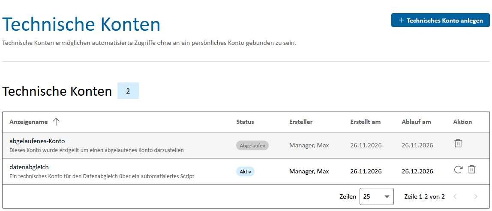
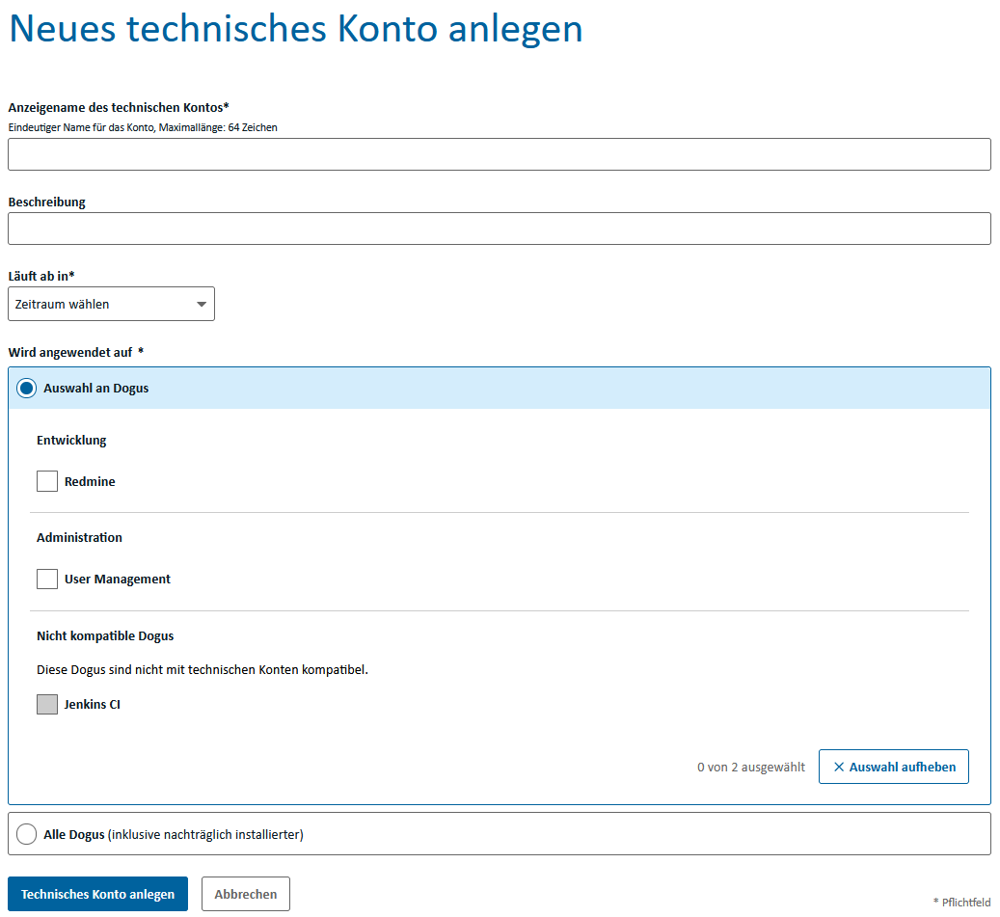
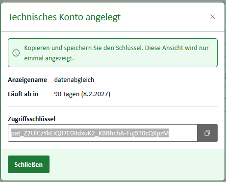
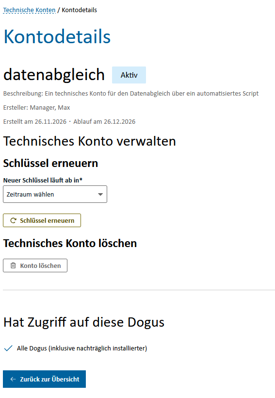

# Technische Konten

Technische Konten ermöglichen Anwendungen und automatisierten Abläufen den Zugriff auf das Cloudogu EcoSystem, ohne dafür das persönliche Konto eines Mitarbeiters zu verwenden. Ein Beispiel ist ein Dienst, der regelmäßig Daten aus einem Dogu abruft.

Zu jedem technischen Konto gehört ein Zugriffsschlüssel. Diesen hinterlegen Sie in der Anwendung, die das Konto verwenden soll. Sie legen fest, für welche Dogus der Schlüssel gilt und wie lange er gültig ist.

## Die Übersicht öffnen

Melden Sie sich mit einem Konto mit Managerrechten am Cloudogu EcoSystem an. Öffnen Sie das **User Management** über das Warp-Menü und wählen Sie **Technische Konten**.

Die Übersicht zeigt die vorhandenen technischen Konten mit Anzeigename, Status, Ersteller, Erstellungsdatum und Ablaufdatum. Eine hinterlegte Beschreibung steht unter dem Anzeigenamen. Klicken Sie auf den Anzeigenamen, um die Beschreibung, den Ersteller und die freigegebenen Dogus zu sehen. Existiert das hinterlegte Erstellerkonto nicht mehr, zeigt die Oberfläche **gelöschtes Konto** an.

## Ein technisches Konto anlegen

1. Klicken Sie in der Übersicht auf **Technisches Konto anlegen**.
2. Tragen Sie unter **Anzeigename des technischen Kontos** einen eindeutigen Namen ein, zum Beispiel `datenabgleich`. Der Name muss 2 bis 64 Zeichen lang sein. Erlaubt sind Buchstaben von a bis z und A bis Z, Zahlen sowie Bindestriche, Unterstriche, Punkte und das Zeichen @. Leerzeichen und Umlaute sind nicht erlaubt.
3. Geben Sie bei Bedarf unter **Beschreibung** den Zweck des Kontos an.
4. Wählen Sie unter **Läuft ab in** eine Gültigkeitsdauer: **7 Tage**, **30 Tage**, **60 Tage**, **90 Tage** oder **Nie**.
5. Legen Sie unter **Wird angewendet auf** fest, welche Dogus die Anwendung erreichen darf. Mit **Auswahl an Dogus** wählen Sie die benötigten Dogus einzeln aus. **Alle Dogus** umfasst auch später installierte Dogus. Als **Nicht kompatible Dogus** gekennzeichnete Einträge können Sie nicht einzeln auswählen.
6. Klicken Sie auf **Technisches Konto anlegen**.
7. Kopieren Sie den angezeigten Zugriffsschlüssel über das Kopiersymbol und speichern Sie ihn sicher, beispielsweise in einem Passwortmanager.
8. Hinterlegen Sie den Schlüssel in der Anwendung, die das technische Konto verwenden soll. Falls diese einen Benutzernamen benötigt, verwenden Sie den beim Anlegen vergebenen Kontonamen.

Beim Anlegen hinterlegt das User Management Ihr angemeldetes Konto als **Ersteller**.

**Der vollständige Zugriffsschlüssel wird nur einmal angezeigt.** Kopieren Sie ihn, bevor Sie den Dialog schließen. In den Kontodetails können Sie ihn später nicht erneut aufrufen.

## Den Zugriffsschlüssel erneuern

Erneuern Sie den Schlüssel, wenn seine Gültigkeit bald endet oder Sie einen neuen Schlüssel für das bestehende Konto benötigen. Beim Erneuern über die Oberfläche bleiben das technische Konto, seine Beschreibung, der hinterlegte Ersteller und die Auswahl der freigegebenen Dogus erhalten.

1. Öffnen Sie die Übersicht **Technische Konten**.
2. Klicken Sie auf den Anzeigenamen des gewünschten Kontos.
3. Wählen Sie im Abschnitt **Technisches Konto verwalten** unter **Neuer Schlüssel läuft ab in** eine neue Gültigkeitsdauer, zum Beispiel **30 Tage**. Bei einem noch aktiven Schlüssel mit Ablaufdatum können Sie auch das bisherige Ablaufdatum auswählen.
4. Klicken Sie auf **Schlüssel erneuern**.
5. Kopieren Sie den neu angezeigten Schlüssel und speichern Sie ihn sicher. Auch dieser Schlüssel wird nur einmal angezeigt.
6. Ersetzen Sie den bisherigen Schlüssel in allen Anwendungen, die dieses technische Konto verwenden.

**Der alte Schlüssel wird beim erfolgreichen Erneuern sofort ungültig.** Planen Sie deshalb ein, die Zugangsdaten der betroffenen Anwendungen direkt anschließend zu aktualisieren. Bis dahin können diese mit dem alten Schlüssel nicht mehr zugreifen.

Auch bei einem bereits abgelaufenen Schlüssel können Sie über die Kontodetails eine neue Gültigkeitsdauer wählen und einen neuen Schlüssel erzeugen.

### Direkt aus der Übersicht erneuern

Über das Symbol **Erneuern** in der Spalte **Aktion** können Sie einen Schlüssel direkt ersetzen. Dabei bleibt das bisherige Ablaufdatum erhalten; die Laufzeit wird dadurch nicht verlängert. Verwenden Sie die Kontodetails, wenn Sie eine neue Gültigkeitsdauer festlegen möchten, insbesondere bei bereits abgelaufenen Schlüsseln.

## Wenn etwas nicht funktioniert

- **Der Bereich Technische Konten fehlt:** Prüfen Sie, ob Sie mit einem Konto mit Managerrechten angemeldet sind.
- **Der Name wird abgelehnt:** Prüfen Sie Länge und erlaubte Zeichen. Der Name darf außerdem nicht bereits vergeben sein.
- **Ein Dogu ist nicht auswählbar:** Als nicht kompatibel gekennzeichnete Dogus unterstützen technische Konten nicht.
- **Der Schlüssel wurde nicht gespeichert oder ist verloren gegangen:** Erneuern Sie ihn über die Kontodetails und hinterlegen Sie den neuen Schlüssel in den betroffenen Anwendungen.
- **Eine Anwendung hat nach dem Erneuern keinen Zugriff mehr:** Prüfen Sie, ob dort bereits der neue Schlüssel hinterlegt ist.
