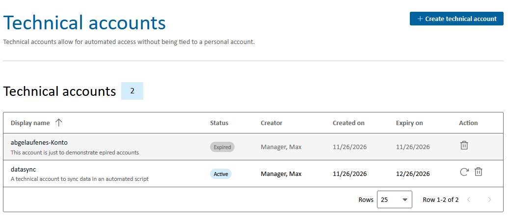
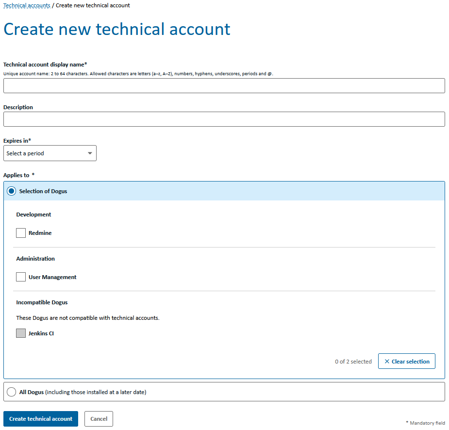
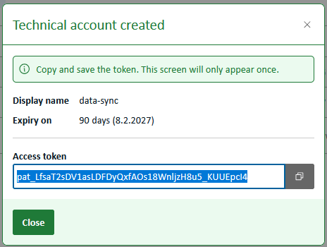
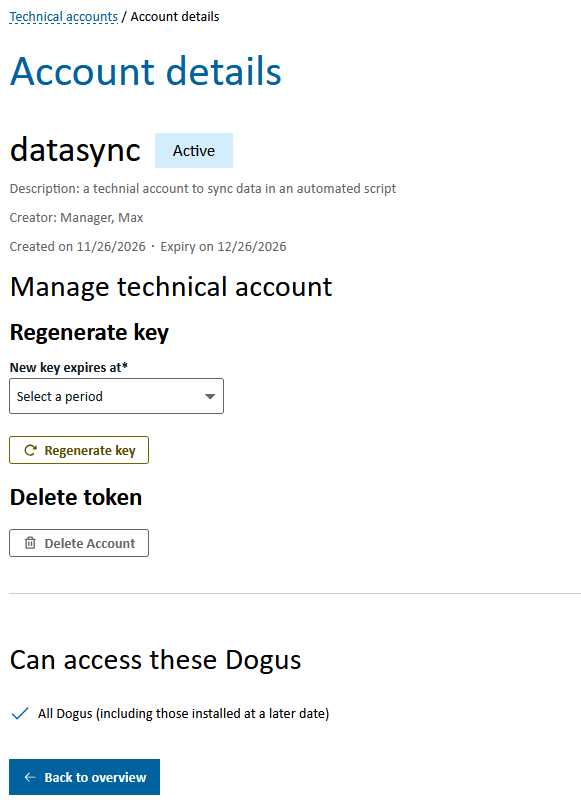

# Technical accounts

Technical accounts allow applications and automated processes to access the Cloudogu EcoSystem without using an employee's personal account. One example is a service that regularly retrieves data from a Dogu.

Each technical account has an access token. You store this token in the application that will use the account. You decide which Dogus the token can access and how long it remains valid.

## Opening the overview

Sign in to the Cloudogu EcoSystem with an account that has manager permissions. Open **User Management** from the Warp menu and select **Technical accounts**.

The overview lists existing technical accounts with their display name, status, creator, creation date, and expiry date. A description, if provided, appears below the display name. Click the display name to see the description, the creator, and the Dogus the account can access. If the recorded creator account no longer exists, the interface shows **deleted account**.

An email reminder is sent 30, 14, 7 and 1 day(s) before the access token expires.

## Creating a technical account

1. In the overview, click **Create technical account**.
2. Enter a unique name under **Technical account display name**, for example `data-sync`. The name must contain 2 to 64 characters. Allowed characters are letters from a to z and A to Z, numbers, hyphens, underscores, periods, and the @ sign. Spaces and umlauts are not allowed.
3. Optionally, enter the purpose of the account in **Description**.
4. Under **Expires in**, choose a validity period: **7 days**, **30 days**, **60 days**, **90 days**, or **Never**.
5. Under **Applies to**, specify which Dogus the application can access. Choose **Selection of Dogus** to select the required Dogus individually. **All Dogus** also includes Dogus installed later. Entries marked as **Incompatible Dogus** cannot be selected individually.
6. Click **Create technical account**.
7. Use the copy icon to copy the displayed access token and store it securely, for example in a password manager.
8. Store the token in the application that will use the technical account. If the application requires a username, use the account name you entered when creating the account.

User Management records your signed-in account as the **Creator** when you create the technical account.

**The full access token is displayed only once.** Copy it before closing the dialog. You cannot view it again later in the account details.

## Renewing the access token

Renew the token when it is about to expire or when you need a new token for the existing account. Renewal through the interface preserves the technical account, its description, its recorded creator, and its selection of permitted Dogus.

1. Open the **Technical accounts** overview.
2. Click the display name of the account you want to manage.
3. In the **Manage technical account** section, select a new validity period under **New token expires in**, for example **30 days**. If the current token is still active and has an expiry date, you can also select that existing expiry date.
4. Click **Renew token**.
5. Copy the newly displayed token and store it securely. This token is also displayed only once.
6. Replace the previous token in all applications that use this technical account.

**The old token becomes invalid as soon as renewal succeeds.** Plan to update the credentials in the affected applications immediately afterwards. Until then, these applications can no longer access the system using the old token.

An email notification is sent after successful renewal.

Even if a token has already expired, you can select a new validity period in the account details and generate a new token.

### Renewing directly from the overview

Use the **Renew** icon in the **Action** column to replace a token directly. This keeps the existing expiry date; it does not extend the validity period. Use the account details if you want to set a new validity period, especially for tokens that have already expired.

## Troubleshooting

- **The Technical accounts section is missing:** Check that you are signed in with an account that has manager permissions.
- **The name is rejected:** Check its length and allowed characters. The name must also be unique.
- **A Dogu cannot be selected:** Dogus marked as incompatible do not support technical accounts.
- **The token was not saved or has been lost:** Renew it in the account details and store the new token in the affected applications.
- **An application loses access after renewal:** Check that the new token has been stored in the application.
